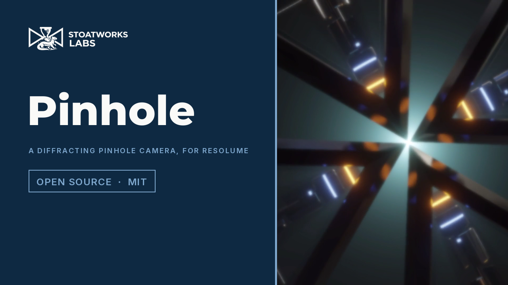

# pinhole

> **AI-assisted project.** This codebase was created with [Claude](https://claude.com/claude-code)
> (Anthropic), directed and reviewed by a human author. It has been loaded into Resolume
> Arena on macOS and on Windows and ran there, over still pictures (see [Status](#status)).
> Everything else below is established by an offline harness, `phtest`, that drives
> the real plugin class through the same `ProcessOpenGL` a host calls, in a headless GL
> context, on this Mac's GPU at two rasters and on Apple's software renderer. The plugin's
> Fresnel pattern builder reproduces **69 of the 80** values of Lommel's tables that Rayleigh
> printed in 1891 to half their last digit, and Rayleigh's closed form on the axis to
> **1.5e-5** of the peak. Read off the picture, an edge's spread is a disc's for a big hole
> (**24.04 px** against 24.24) and a band-mean Airy pattern's for a small one, red against blue
> **1.425** against 1.447; a point's image is tightest at **1.0–1.5%** below
> Mielenz's optimum hole, 1.844 √(λf), in each colour; the corners fall as cos⁴ to **2.8e-4**.
> **17** deliberately wrong models and all **51** one-character mutants of the shipped code
> are caught. The screen's size, the colour bands and the Exposure default are **chosen**, not
> measured: see [Status](#status).

A pinhole camera and camera obscura looking at your clip, for
[Resolume](https://resolume.com) Arena and Avenue: an FFGL effect, **SW Pinhole**.

There is no lens. The clip is the scene, and a hole in a thin plate throws it onto a screen.
**The hole does not blur a sharp picture; it makes the picture by diffraction.** Every point
of the scene lights the screen with the Fresnel pattern of a round hole, one pattern per
wavelength, and the picture is the sum of those patterns. So the picture is sharpest at one
hole size and softer either side of it: a smaller hole spreads light by diffraction, a larger
one by its own shadow. Small holes make red edges spread further than blue ones; near the best
hole the pattern's middle is up to four times brighter than the open light, and a pinhole
picture carries a faint veil of light from its patterns' outer rings. The corners darken as
cos⁴ of the angle off the axis, hard for a short box and barely for a long one. Swap the hole
for a **Fresnel zone plate** and it focuses harder, but one colour at a time: the colour the
plate is made for comes sharp and the others land around it as soft coloured light. Nothing is
drawn: all of it comes out of one Fresnel integral over the aperture's open rings.

**Photosensitivity.** The camera keeps the clip's light (it moves light about the frame, a
frame's light stays the frame's), so at its default Exposure it flashes only where the clip
does: measured with the WCAG general-flash rule (more than three flashes a second over the
whole frame or any third-of-frame window), none of Resolume's 33 demo clips crosses the line
through it at the defaults, with the zone plate or at the largest blur. **Exposure turns a
clip's own pulses up with the picture:** at +1 stop none crosses, at +2 stops **3** do where
the bare clips did not, and at +4 stops **4**. The [user guide](docs/USER-GUIDE.md#flashing)
has the numbers.

<!-- downloads:start -->

## Download

**[v0.1.0](https://github.com/stoatworks-labs/pinhole/releases/tag/v0.1.0)** — prebuilt for macOS and Windows. Pick your platform:

<details>
<summary><b>macOS</b> — Universal (Apple Silicon + Intel)</summary>

| Build | Download | Size |
| --- | --- | --- |
| Universal (Apple Silicon + Intel) · .dmg disk image | [`pinhole-0.1.0-macos-universal.dmg`](https://github.com/stoatworks-labs/pinhole/releases/download/v0.1.0/pinhole-0.1.0-macos-universal.dmg) | 238 KB |
| Universal (Apple Silicon + Intel) · .zip archive | [`pinhole-macos-universal.zip`](https://github.com/stoatworks-labs/pinhole/releases/latest/download/pinhole-macos-universal.zip) | 196 KB |

</details>

<details>
<summary><b>Windows</b> — x64</summary>

| Build | Download | Size |
| --- | --- | --- |
| x64 · .exe installer | [`pinhole-0.1.0-windows-x86_64-setup.exe`](https://github.com/stoatworks-labs/pinhole/releases/download/v0.1.0/pinhole-0.1.0-windows-x86_64-setup.exe) | 252 KB |
| x64 · .zip archive | [`pinhole-windows-x86_64.zip`](https://github.com/stoatworks-labs/pinhole/releases/latest/download/pinhole-windows-x86_64.zip) | 123 KB |

</details>

All builds, checksums and release notes: [github.com/stoatworks-labs/pinhole/releases](https://github.com/stoatworks-labs/pinhole/releases).

macOS builds are signed and notarised and open normally. The Windows builds are unsigned, so SmartScreen warns once.

<!-- downloads:end -->

## Video

> **Photosensitivity warning:** raising this effect's Exposure turns a clip's own pulses up,
> so a pulsing clip can flash brightly through it. Large-area flashes in the video are kept to
> three a second or fewer.

[](https://www.youtube.com/watch?v=Jcs8DmTnOKc)

## Controls

| Group | |
| --- | --- |
| **Camera** | Aperture (Pinhole or Zone Plate), Diameter (the hole, 0.1–2 mm), Open Zones (the plate's open rings, 1–16: 2n − 1 zones, the centre and the edge open), Zone Focus (the colour the plate brings to focus on the screen, 400–700 nm), Distance (hole to screen, 10–500 mm). |
| **Picture** | Exposure (−4 to +4 stops), View (Upright, or Obscura: turned 180°, as on the wall of a camera obscura), Edge (Mirror: the scene carries on past the frame; Black: a picture on a black wall). |
| **Look** | Mix. |

The screen is a 24 mm tall frame (a 35 mm film frame's height) at any raster, so the blur is
the same picture at 720p and 4K. The defaults are a 0.31 mm hole 50 mm from the screen, the
sharpest hole for that box in green light (Mielenz's optimum), and four open zones focusing
550 nm when the plate is chosen. **Exposure starts at +0.2 stops, set from Resolume's own demo
clips**: the blur keeps the light, so a picture only loses brightness to the dark corners, and
+0.2 stops is what an averaging meter sets on the median of Arena's 33 demo clips (it brings
that clip's mean back to 1.02 of its own).

Diameter is the pinhole's; Open Zones and Zone Focus are the plate's. Each does nothing under
the other Aperture.

Over a transparent part of a clip the screen still shows light spread from the clip's opaque
parts; a transparent pixel sends the hole no light. The output is opaque at Mix 1.

**Moving lights.** A lone point of light on black changes shape slightly as it moves at
large blurs, the same shape again every 16 px of travel at 1080p, almost all of it in its
faint outer rim. It did not show on a real clip (Resolume's Beat 006, a turning structure
studded with lamps, at the largest blur): see [Not established](#not-established).

## Status

**v0.1.0, 18 November 2026, and early days.** It has been loaded into Resolume Arena on
Windows and on macOS (below), over still pictures: never a moving clip, never in a show. The
macOS build is Developer ID-signed and notarised. There's a [user guide](docs/USER-GUIDE.md)
and a [browser demo](#browser-demo), but no OpenFX port and no presets.

### In Resolume


<sub>SW Pinhole inside Resolume Arena 7.29.0 on an Apple M4 Max, from Arena's composition
snapshot over REST, 18 November 2026, over a still of the harness's test card. Left: Distance
10 mm, a short box, whose corners fall to 11% of the centre's brightness. Right: Aperture Zone
Plate with 16 open zones, the rest at the defaults.</sub>

- **Windows: Arena 7.27.1 on win-lab, software rendering (Mesa llvmpipe, no GPU)**, the
  release's own x64 DLL (from `pinhole-windows-x86_64.zip`), through the fleet's Arena gate
  on 18 November 2026, shortly after the tag: **9 passed, 0 failed, 0 skipped**, as the DLL
  built from the same source before the tag had passed with the same numbers. Arena loaded it and registered `SW Pinhole` `PC01`
  as an effect; all 15 controls (its 14 parameters and Arena's Opacity) matched name, order,
  type, range and default, the two names at Arena's length limit whole; the frame had content,
  14.2 levels from the bare input at the defaults against a 0.00-level noise floor; and all 10
  controls moved the picture, Open Zones and Zone Focus with the zone plate chosen and Edge in
  a long box (Exposure 73.2 levels, View 61.7, Distance 47.6, Diameter 17.7, Mix and Opacity
  14.2, Aperture 9.2, Open Zones 9.0, Zone Focus 2.6, Edge 2.2). No shader or error lines in
  Arena's log, and Arena stayed up. The four link buttons are listed, not pressed (they open a
  browser).
- **macOS: Arena 7.29.0 on an Apple M4 Max**, a local universal build of this source (ad-hoc
  signed, not the notarised download), mounted on a clip over Arena's REST API and read off
  Arena's composition snapshot (sharpness and differences over the middle three fifths of a
  1920×1080 JPEG, the corners over the whole frame), over a still of the harness's test card:
  - all **15** controls shown (with Arena's own Opacity) at the declared defaults, and the
    About line `Pinhole v0.1.0 - MIT - Stoatworks Labs, stoatworks-labs.com`;
  - two snapshots a second apart at the defaults differ by **0.0** levels a pixel: the camera
    keeps no time and draws nothing random. Mix 0 gives the bare still exactly (**0.0**);
  - Diameter: the picture's sharpness (the mean gradient, in levels) is **3.76** at the default
    0.31 mm, **3.22** at 0.1 mm (diffraction) and **0.95** at 2 mm (the hole's shadow):
    sharpest at the default, as meant. Back at the default, the picture came back exactly;
  - Distance 10 mm leaves the corners at **0.111** of the centre's brightness (0.606 at the
    default 50 mm, 0.819 on the bare still); 500 mm softens the picture to a sharpness of 1.13;
  - Exposure −4 and +4 stops take the mean from 97.4 levels to **20.1** and **208.7**;
  - View Obscura is the default picture turned 180° to within **0.42** levels a pixel, JPEG's
    noise;
  - Edge Black changes only the frame's border at the defaults (the corners 0.606 → 0.598 of
    the centre, the middle unchanged), as the guide says;
  - Zone Plate (4 open zones, 550 nm) softens the picture to 2.19, 16 zones to **1.51**, and
    1 zone gives the best pinhole's picture back to within 0.4% (3.78 against 3.76): one open
    zone is about the best hole. Zone Focus at 400 and 700 nm each moved it (2.3 and 2.0
    levels); which colour comes sharp was not read off the snapshot (the harness measures it,
    below);
  - Open Zones and Zone Focus under Pinhole, and Diameter under Zone Plate, change nothing
    (**0.0**);
  - the probe's own layer was removed and Arena was quit without saving.

Not measured in Resolume: its cost, a moving clip, whether Arena hands an effect straight or
premultiplied colour (the plugin assumes straight), and any GPU but the M4 Max and llvmpipe.

### Measured offline, on macOS

`tools/verify.sh` (below) ends **all green**, exit 0, on an Apple M4 Max; without `OXBOW` it
fails at the bundle step, as it should. Every picture check runs at **two rasters**, 1280×720 and 320×180, and again on
**Apple's software renderer** at 320×180 (`--optimum`, which needs 1280×720, at 1280×720
there). The numbers below are from `phtest --all` on the same code (an arm64 build).

| check | result |
| --- | --- |
| `--fresnel` | the pattern builder (no GL): Lommel's tables as Rayleigh prints them, **69 of 80** values to 5e-5 (half the last printed digit; the 11 others are listed, and one, 3π at z = 10, disagrees with the table's own minimum row); the axis against Rayleigh's 4 sin²(u/4) to **1.5e-5** of the peak and the light through the hole against πu² to **5.6e-5**, u from π/2 to 40π; the Airy limit (u = 0.01) against libm's j1 to **3.1e-5**; a big hole's edge spread 0.80761 a against a disc's 0.80795 a; the area width least at u = **1.688π** (Mielenz: 1.7π); zone plates' axes against (2M)² to **1e-8**; the plugin's own sampling against four times as fine, **5.4e-4** of the peak; its cumulative light exact to **1e-14**; the pyramid's taps holding the light inside the support to **3.9e-4** |
| `--blur` | a white edge's spread off the picture: a 2 mm hole at 10 mm, R G B **24.04–24.07 px** against a disc's 24.24 (±3); a 0.1 mm hole at 500 mm, R **60.43**, G **51.51**, B **42.40 px** against the band-mean Airy patterns' 62.66, 52.99, 43.32 (±5), red over blue **1.425** (1.447); at 320×180 within 0.6 px of the same |
| `--optimum` | a point's image over 25 diameters at 500 mm (1280×720): the area width least at **1.0403, 0.9554, 0.8619 mm** for R, G, B, against Mielenz's 1.0512, 0.9670, 0.8746 (−1.03%, −1.19%, −1.45%; tolerance 1.5% + 2.2%); the same on the software renderer |
| `--falloff` | a flat field against cos⁴ of the field angle at 10, 25 and 50 mm (the corner gets 0.0205, 0.2612, 0.6512 of the centre): worst **2.8e-4** (tolerance 0.002) |
| `--zone` | an 8-open-zone plate at 500 mm, Zone Focus 400–700 nm: each channel's point is sharpest when the plate is made for its band, R at **650**, G at **540**, B at **440 nm** (550 and 450 at 320×180) |
| `--edges` | Mirror: the card against the middle of the card between its own mirror images, **0** difference (tolerance 1e-5); upside down against upside down to **9.2e-5**; Black: a white strip against each of the four edges symmetric to **4.6e-5** |
| `--energy` | a 9 × 9 white square: the picture's light **0.99953–1.00000** of the clip's (tolerance 0.002); the picture symmetric under swapping x and y; the centroid within **0.0036 px** of where the pyramid puts it (0.16 px off the square's centre at 720p for a plate: see [Not established](#not-established)) |
| `--view` | Obscura moves a marked pixel exactly to the opposite corner |
| `--alpha` | alpha = mix(α, 1, Mix) to **3e-8**; white under transparent pixels changes nothing; grey under an alpha ramp comes out as the grey's light times α to **3.2e-4**; Mix 0 the clip bit for bit. On two of Arena's own alpha clips, white painted under every transparent pixel changes **0** output bytes |
| `--resize` | 640×360 → 320×180 mid-run against a fresh instance: **0** difference |
| `--glstate` | the host's GL state comes back, **0** things changed |
| `--pipe` | 2.5 frames in, exactly 2 out; bad cues and settings refused; a closed stdout (`\| head -c 1`) exits 1, not 141 |
| `--negative` | **17** deliberately wrong models, **17** caught |
| mutation | **51** one-character mutants of the shipped GLSL and C++, **51** caught, each by the check named for it (`AGENTS.md` lists them) |
| `tools/sweep.py` | all **9** controls measurably change the picture |
| shaders | all 5 compile through `glslc`, not merely through Apple's driver |
| the bundle | universal (`x86_64 arm64`), exports `plugMain`, ad-hoc signs; `oxbow` reads `SW Pinhole` / `PC01` / `effect` and renders through it |

### Cost

GPU time a frame (`GL_TIME_ELAPSED`, the median and the worst of the run) on the harness's
card, from `phtest --bench` on an Apple M4 Max in a quiet moment (the pre-flight run on the
release's code):

| raster | the defaults (0.31 mm at 50 mm) | the largest blur (0.1 mm at 500 mm) |
| --- | --- | --- |
| 1280×720 | **2.35 ms** | **2.81 ms** |
| 1920×1080 | **4.85 ms** | **5.37 ms** |
| 3840×2160 | not run | **17.78 ms** (worst **18.11**): **over a 60 fps frame** (16.7 ms) on its own |

The kernel's levels grow with the blur (3 to 7 at 720p, 4 to 8 at 1080p, 9 at 4K) and each
level is at most 241 taps, so the largest blur costs little more than the defaults. The CPU
rebuilds the patterns and taps in 10–11 ms, only when the aperture, the distance or the
raster's height changes. The GPU is shared, and it shows: the same bench run while Resolume
Arena and other work were running on the Mac gave 2.71, 3.29, 5.63 and 8.31 ms, and **30.75
ms** at 4K (worst 34.03). No other GPU has been measured, and nothing inside Resolume.

### Not established

- **Resolume, beyond a still picture.** It has loaded in Arena on macOS and Windows (above),
  never on a moving clip, never in a show, never in Avenue.
- **Moving lights.** The pyramid (below) makes the plugin slightly shift-variant: a lone point
  of light on black changes shape as it moves, the same shape again every 16 px of travel at
  1080p. Measured with the release's moving-dot check (a Gaussian dot sliding through
  `phtest --pipe`, each frame against the same frame moved by whole pixels): at the largest
  blur two positions 8 px apart differ by up to **25%** of the point's picture, almost all in
  its faint outer rim (the rim's own picture changes by up to 85%), which breaks into notches
  and closes again; with a 16-zone plate **3.8%**; near the defaults **0.2%**. On a real clip it did not
  show: Resolume's Beat 006 at the largest blur, watched frame by frame, its lamps' discs move
  smoothly, and the picture's frame-to-frame roughness (the second difference in time over
  the first) is **0.87**, against **0.99** for the same clip under a shift-invariant Gaussian
  blur. A bright lamp on black at a long Distance or with many zones is where to look for it.
  Storing the pyramid in full floats or making it finer would cost GPU time; not tried.
- **Chosen, not measured:** the screen's 24 mm height (a 35 mm frame's), the three colour
  bands (400–500, 500–600, 600–700 nm, flat), the cut at 99% of each pattern's light (the last
  1% is dropped, so a bright light's widest veil is a little short; widening the cut costs
  taps), and the Exposure default's criterion (an averaging meter).
- **What Fresnel's approximation leaves out:** the scene at a finite distance, the obliquity
  factor, the hole's thickness and its own vignetting, polarisation. One pattern serves the
  whole frame, so the pattern's growth off the axis is left out.
- **The pyramid is not exact.** Each pattern's outer rings are gathered from coarser and
  coarser texels: a feature at radius r is smeared by about a texel of the level holding it,
  and a coarse level sees a texel's light at its centre, so a point's light moves by up to
  0.67 px with its position against the coarse grid (measured at 720p, four open zones). The
  pyramid stores half floats: a lone white pixel on black loses 0.9% of its light, in the
  far rings. Mirror is exact only where the coarsest texels divide the frame.
- **The zone plate's orders** (the booklet's 25% zero order, 10% first order) are checked
  through the plate's axis and its light, not read off the picture.
- **Resolume's alpha.** The plugin treats a clip's colour as straight alpha, which is what
  Arena's DXV demo clips decode to; whether Resolume hands an effect premultiplied colour has
  not been checked.
- **The best hole sits 1.0–1.5% below Mielenz's** in the harness's measurement (above), in
  every colour, within the check's tolerance. The default is Mielenz's; whether the 1.7π
  criterion or the measured optimum is the better default has not been settled, and nobody is
  likely to see the difference.
- **The edges of the range:** Distance below 10 mm and a hole above 2 mm are not reachable.
- The Exposure default was measured on the demo clips through `--pipe`, not looked at in a
  show; a centre-weighted meter would have chosen differently.
- No presets and no OpenFX port.

## Browser demo

[pinhole-demo.stoatworks-labs.com](https://pinhole-demo.stoatworks-labs.com/) runs the
plugin in your browser: its own C++, the plugin class with its Fresnel pattern builder,
compiled unmodified to WebAssembly and drawing with its own GLSL in WebGL2. The page is the
host, the clips are generated (or a picture of your own) and the raster is the page's. A
frame of the page matched `phtest --pipe`'s on the same input and settings in nine cases:
seven byte for byte, two by one 8-bit code in a handful of values. It is a demo, not the
plugin, and the page lists what it leaves out.

## Build

macOS (universal: Apple Silicon and Intel):

```bash
git clone --recursive <this repo>
```

```bash
cmake -B build -DCMAKE_BUILD_TYPE=Release
```

```bash
cmake --build build
```

```bash
cmake --install build
```

The last one copies `Pinhole.bundle` into `~/Documents/Resolume Arena/Extra Effects`.
Restart Arena and it's under Effects as **SW Pinhole**.

## Building and testing

```bash
OXBOW=/path/to/oxbow tools/verify.sh
```

That's the whole lot: shader hygiene and `glslc`, a fresh universal build with no warnings,
the bundle's architecture, plist and ad-hoc signature, a host's view of it through `oxbow`
(required), every check at two rasters and again on the software renderer, the alpha check on
Arena's demo clips (required), the pipe, the negative controls, the mutants, the sweep for
dead controls and the render cost. CI (`ci.yml`) builds on macOS and Windows and runs the
checks that need no GL; the pixel checks need a GPU, so this script is where they run.
`CLAUDE.md` lists the checks one by one; `./build/phtest --all` runs them all.

Render a frame of your own:

```bash
./build/phtest --out /tmp/pinhole.png --set "Aperture=Zone Plate" --set "Open Zones=8"
```

Run a clip through it:

```bash
ffmpeg -nostdin -i in.mov -f rawvideo -pix_fmt rgba - | ./build/phtest --pipe --size 1280x720 | ffmpeg -f rawvideo -pix_fmt rgba -s 1280x720 -r 30 -i - out.mov
```

## License

MIT. See [LICENSE](LICENSE) and [ATTRIBUTIONS.md](ATTRIBUTIONS.md).

<!-- attributions:start -->
This project is built on other people's work — see [ATTRIBUTIONS.md](ATTRIBUTIONS.md).
<!-- attributions:end -->
